# THE NEST — гайд по игре

Здесь собрано всё, что нужно знать игроку: как выглядят предметы, где они лежат и что с ними делать.
Картинки сняты в Studio при дневном свете, чтобы было лучше видно. В игре ночь и темно.

---

## Управление

| Клавиша | Что делает |
|---|---|
| `1`, `2`, … | взять предмет в руку (фонарик, бинт, талисман, когти) |
| **ЛКМ** | использовать предмет: включить фонарик, перевязаться, обжечь монстра талисманом, ударить когтями |
| **E** | двери, записки, взять предмет, чинить щиток (держать), рвать кокон (держать) |
| **G** | монстр: бросить тело |
| колесо мыши | приблизить или отдалить камеру |

---

## Как победить

**Выжившие** побеждают, если соберут **талисман** и обожгут им монстра **3 раза**.
**Монстр** побеждает, если убьёт всех выживших раньше.
Времени у раунда нет: игра идёт, пока одна из сторон не победит.

Прогресс виден слева внизу:

```
Талисман: цепочка ?  камень …  оправа ✓
```
`?` — часть ещё спрятана, `…` — её кто-то нашёл, `✓` — она уже на алтаре.

---

## 1. Талисман (оберег Марты)

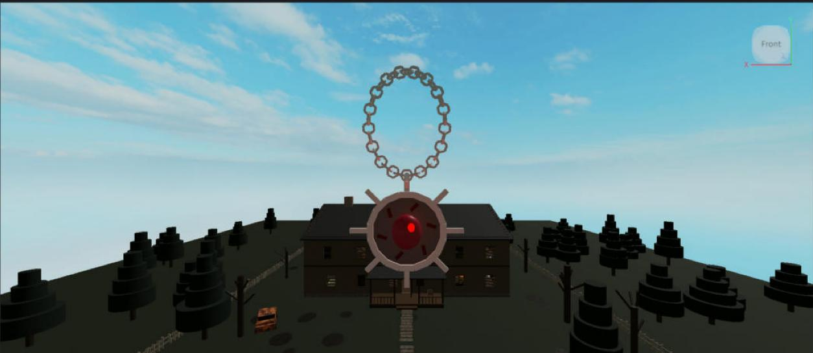

Серебряное «солнце» с рунами, тёмно-красный камень в центре и цепочка.
Это **единственное**, что ранит монстра. Ни фонарик, ни что-то другое его не берёт.

Талисман разделён на **3 части**, и у каждой своя загадка:

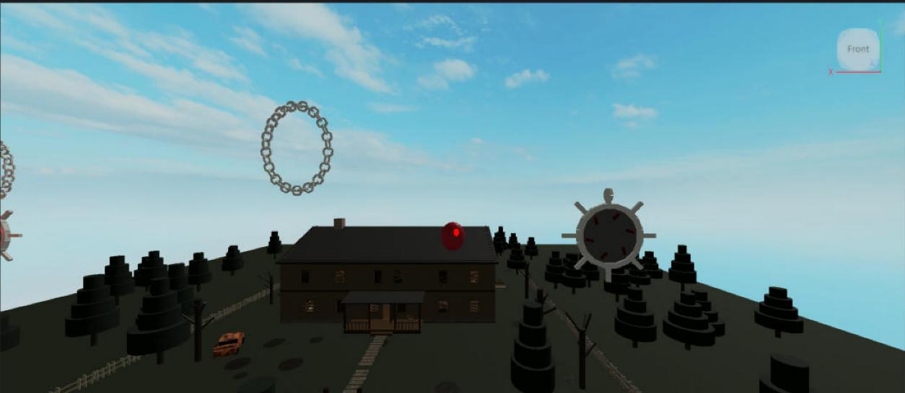

| Часть | Где спрятана | Как достать |
|---|---|---|
| **Цепочка** (слева) | сейф в спальне Томаса | ввести код из 4 цифр |
| **Камень** (в центре) | ящик Томаса в подвале | сначала дать ток — починить щиток |
| **Оправа** (справа) | могила Лили во дворе | зажечь свечи в правильном порядке |

Найденная часть светится. Подойди и нажми **E** «Взять». Если тебя убьют, часть выпадет на пол, и её сможет подобрать другой выживший.

---

## 2. Цепочка — сейф с кодом

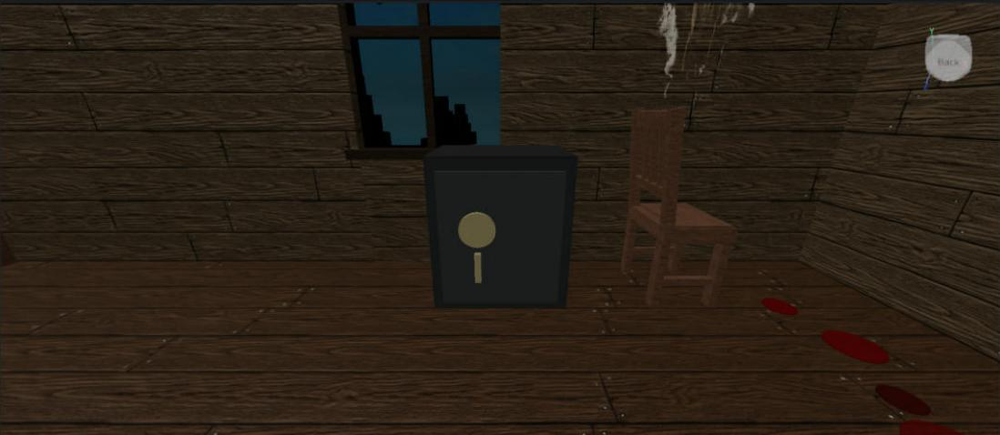

**Где:** второй этаж, **спальня Томаса**, у стены.

**Как открыть:**
1. По дому, подвалу и сараю разбросаны **4 обрывка записок Томаса**. Записки слабо светятся.
2. Подойди и нажми **E** «Прочитать». В каждой записке одна цифра, например «Вторая цифра — 7».
3. Собери все 4 цифры по порядку.
4. У сейфа нажми **E** «Ввести код», впиши 4 цифры и нажми «Открыть».
5. Если код неверный, цифры моргнут красным. Если верный — дверца откроется, внутри цепочка.

Код каждый раунд **новый**.

---

## 3. Камень — ящик с электрозамком

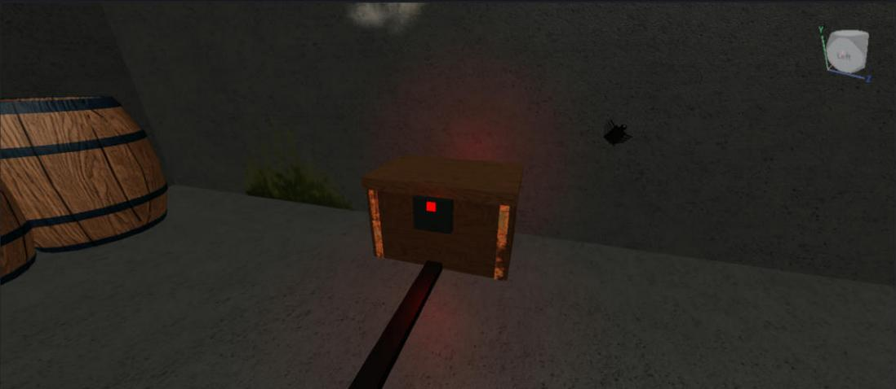

**Где:** подвал, **генераторная** (у стены, к нему тянется провод).

**Как открыть:**
1. Лампочка на замке **красная** — тока нет, ящик не откроется.
2. Почини **уличный щиток** во дворе (см. раздел 6).
3. Когда щиток заработает, лампочка станет **зелёной**.
4. Нажми **E** «Открыть» — крышка поднимется, внутри камень.

**Как попасть в подвал:**
- через дверь в **столовой**, но она заперта: нужен **ключ** (см. раздел 7);
- или через **уличный люк** у левой стены дома (см. раздел 8).

---

## 4. Оправа — свечи у могил

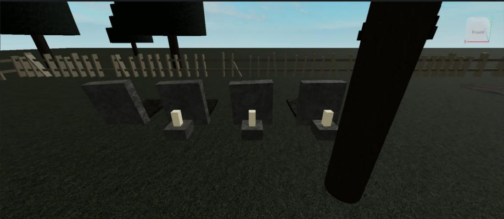

**Где:** задний двор, **могилы Хейлов**. Перед тремя могилами — Томаса, Марты и Лили — стоят свечи.

**Как достать:**
1. Найди **рисунок Лили** в **детской** (второй этаж). Нажми **E**, чтобы прочитать.
2. На рисунке написано, в каком порядке зажигать свечи, например «сначала для мамы, потом для папы, потом для моей».
   Мама — Марта, папа — Томас, «моя» — Лили.
3. Подходи к свечам и нажимай **E** «Зажечь свечу» строго по порядку.
4. Если всё верно, земля на могиле Лили проседает и появляется оправа.
5. **Ошибся** — все свечи гаснут, и раздаётся громкий крик. **Монстр его слышит!** Придётся начать сначала.

Порядок каждый раунд **новый**.

---

## 5. Алтарь — собрать талисман

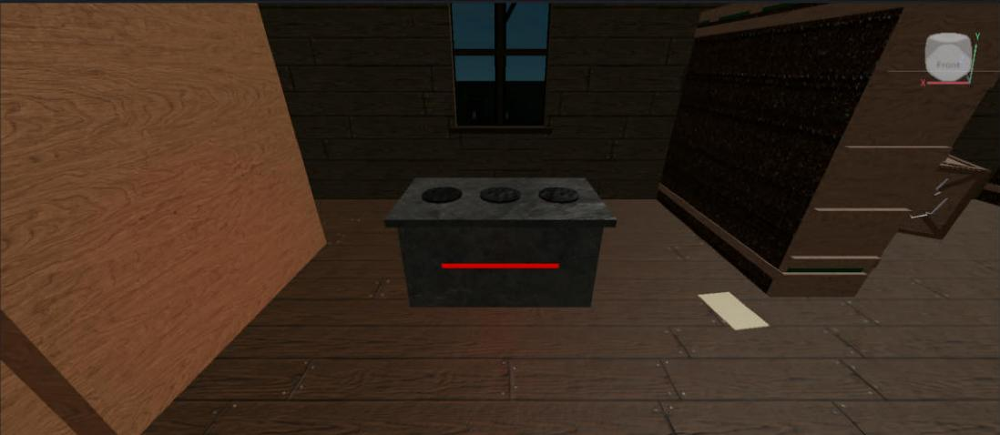

**Где:** первый этаж, **библиотека**. Каменный стол с тремя гнёздами и красными рунами.

1. Принеси части. Можно по одной и разными игроками.
2. Нажми **E** «Положить части».
3. Когда лягут все 3 части, будет вспышка, и на алтаре появится **готовый талисман**.
4. Нажми **E** «Взять талисман».

**Как бить монстра:**
- возьми талисман в руку (`1`/`2`…), подойди к монстру **ближе 9 шагов** и смотри на него;
- нажми **ЛКМ** — камень вспыхнет и обожжёт монстра;
- обожжённый монстр несколько секунд еле идёт;
- между ударами **6 секунд** (таймер виден слева внизу);
- **3 ожога — монстр мёртв**, выжившие победили.

Через стену талисман не бьёт.

---

## 6. Уличный щиток — дать ток

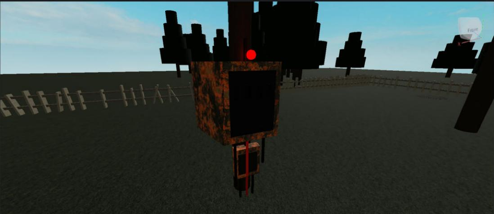

**Где:** задний двор слева, **столб с проводами**. На столбе — ржавый щиток с красной лампочкой.

**Как починить:**
1. Подойди и **держи E** «Чинить».
2. Над щитком растёт полоска: каждые 0.25 сек +1–3%.
3. На 100% лампочка станет **зелёной**, в доме загорится тусклый мигающий свет, а в проводке появится ток.

Зачем нужен ток:
- открывается **ящик Томаса** с камнем;
- фонарик заряжается **быстро** (25 сек вместо 90).

**Монстр может сломать щиток**: каждый его удар снимает 1/6 починки, раз в 10 секунд. При 0% свет снова гаснет.
С одной рукой (если оторвали другую) чинить в 2 раза медленнее.

---

## 7. Фонарик и зарядка

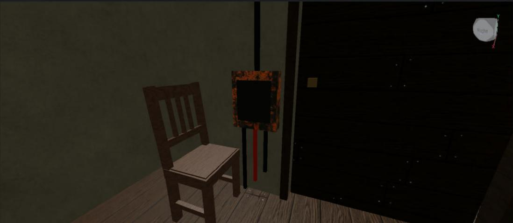

**Фонарик** есть у каждого выжившего: `1` — взять, **ЛКМ** — включить или выключить.
Батарея видна слева внизу. Полного заряда хватает примерно на 6–7 минут. Почти севший фонарик мигает.

**Как зарядить:** найди на стене **ржавую коробку с торчащими проводами** (в холле, на кухне, на втором этаже, в подвале, у щитка) и **держи E**.
- Щиток починен — зарядка быстрая.
- Щиток сломан — медленная.

Фонарик только помогает видеть, **монстра он не отпугивает**.

---

## 8. Подвал: ключ, дверь и люк

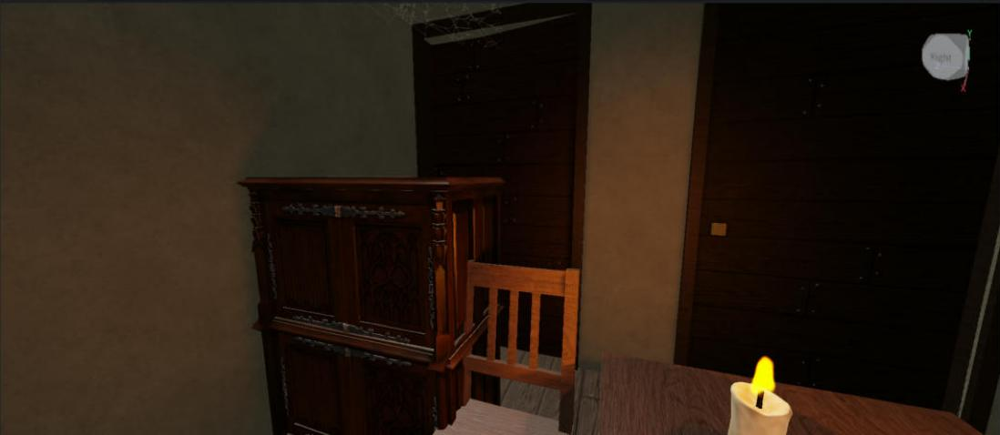

**Дверь в подвал** — в **столовой** (тёмная дверь справа на снимке). Она **заперта**.
**Ключ** лежит в одном из 6 мест: на кухонной стойке, на пианино, на столе в библиотеке, на комоде в детской, на тумбочке Марты или на комоде в спальне. Каждый раунд место новое.
Ключ слабо блестит. Взять — **E**, открыть дверь — **E**. Если тебя убьют, ключ выпадет.

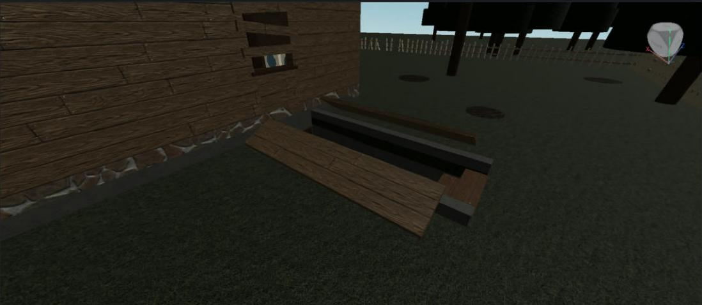

**Уличный люк** — у **левой стены дома**: яма с лестницей вниз и откинутые створки. Ключ не нужен. Ведёт в угольную. Этим путём ходит и монстр.

---

## 9. Бинты и раны

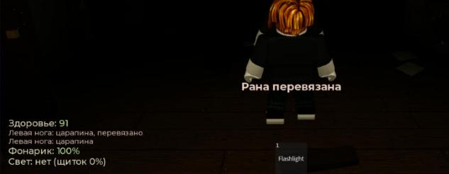

- Бинты лежат в комнатах: 3 в открытых и по 1–2 в закрытых (кладовая, кладовка, подвал, сарай). Подобрать — **E**.
- Использовать — взять «Бинт» в руку и нажать **ЛКМ**. Перевязка длится 3 секунды, всё это время ты идёшь медленно.
- **Царапина** (удар издалека): бинт возвращает +15 HP.
- **Глубокая рана** (удар вплотную): бинт только **останавливает кровь**, HP не возвращает.
- HP сами **не восстанавливаются**.

---

## 10. Монстр

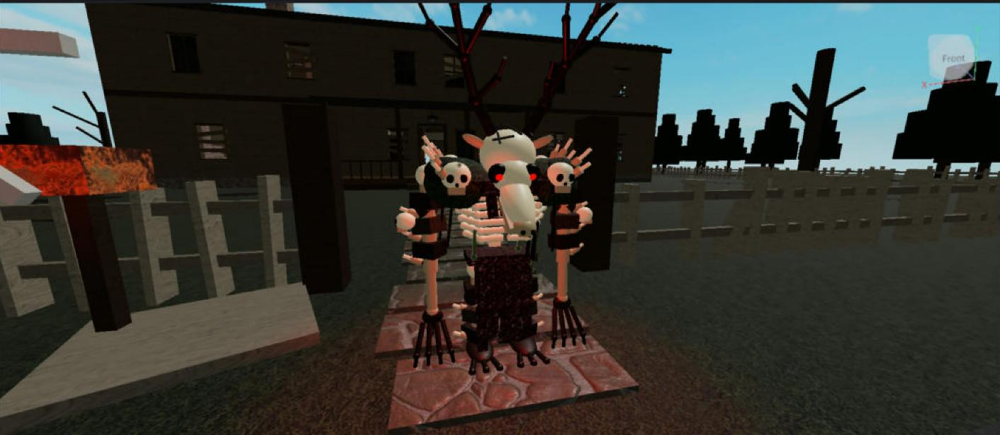
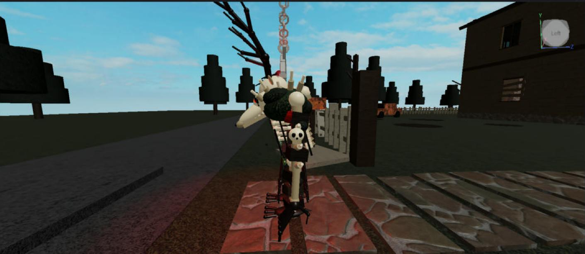

Олений череп с красными глазами, чёрные рога, рёбра, черепа на плечах, длинные когти. Сутулый.

**Если монстр — ты:**
- **ЛКМ** когтями. Издалека — царапина, вплотную — глубокая рана. Удар в голову может ослепить или убить, а рука может оторваться.
- Убитого выжившего возьми **E**, неси на плече (**G** — бросить) и спрячь в тайник (**E**). Тело станет **коконом**.
- Чем меньше ударов ушло на жертву, тем быстрее вылупится кокон.
- Ломай щиток (**E**), чтобы в доме снова стало темно.
- Следи за прогрессом талисмана слева внизу. Если его собрали — беги!

---

## 11. Кокон

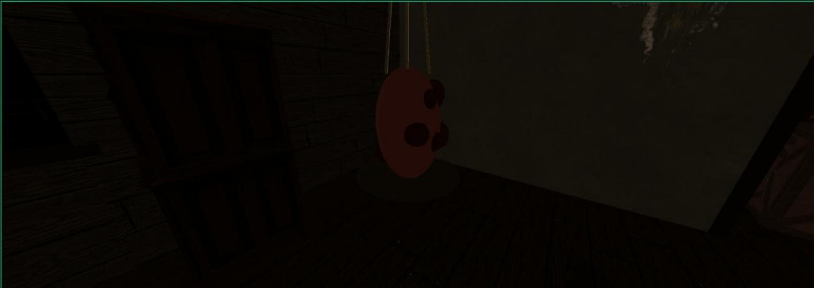

Монстр прячет тела в тайники, и там появляется кокон.
Выжившие ищут коконы **без подсказок**. Нашёл — **держи E**, чтобы рвать: +1–3% каждые 0.75 сек. На 100% кокон уничтожен.

---

## 12. Что ещё есть в доме

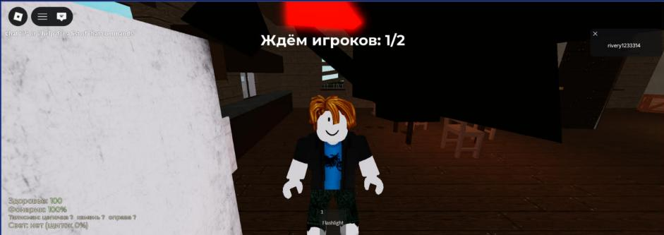

- **Летучие мыши.** За некоторыми дверями (кладовая, кладовка, гостевая, угольная, сарай) сидит стая. Когда откроешь дверь первым за раунд, она вылетит прямо в лицо.
- **Пауки** ползают по стенам и разбегаются, если подойти.
- **Надписи кровью, куклы, кровавые следы** — для атмосферы.
- **Название комнаты** появляется сверху, когда входишь.
- **Музыка** становится тревожнее, и стучит сердце, когда монстр рядом.

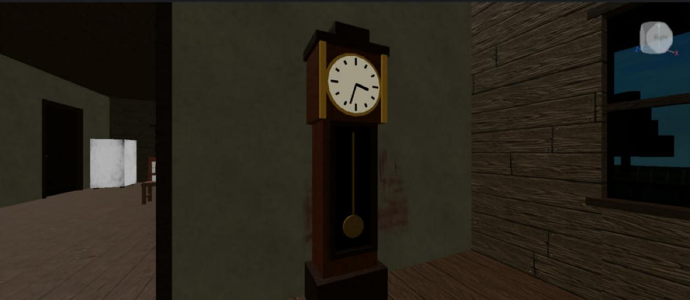

- **Старинные часы** в холле тикают, а стрелки застыли на 3:33.
